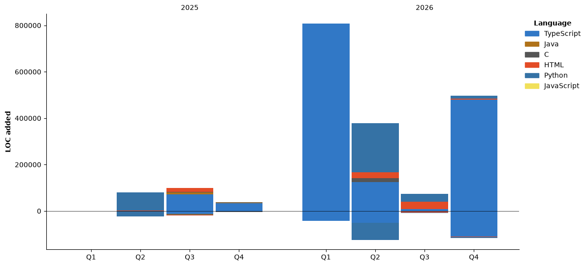

# Hi, I'm Karl Hoang 👋
### Software Engineer

📍 **Perth, Australia**  
📧 [Email Me](mailto:tuankhanh17032003@gmail.com) | 💼 [LinkedIn Profile](https://linkedin.com/in/tuan-khanh-hoang-1a8a9b275) | 🌐 [Portfolio](https://karl-sue.github.io/) 

---

### 🛠️ Technical Skills

**Languages & Backend**  


**Cloud, DevOps & Tools**  


**Frameworks & Web**  


---

### 🚀 Featured Projects

| Project | Description | Key Tech Stack | Links |
| :--- | :--- | :--- | :--- |
| **Rate Pulse** | High-performance FX analytics platform centralizing real-time rates with latency optimized down to ~500ms using PostgreSQL indexes & Redis. | Go (Gin), Next.js, TypeScript, PostgreSQL, Redis, MongoDB, Docker, K8s | [Live App](https://rate-pulse.me) \| [GitHub](https://github.com/ThanhVinhTong/rate-pulse) |
| **Partimark** | Automated assessment & cloud platform featuring serverless triggers, async notifications, and automated CI/CD container deployments. | FastAPI (Python), Azure MySQL, Azure Logic Apps, GitHub Actions | [GitHub](https://github.com/CITS5206-CapstoneTeam03/participation-marking-app) |

---

### 🎓 Education & Certifications

* 🏅 **AWS Certified Developer – Associate** (2025 – 2028) — [Verification Link](https://cp.certmetrics.com/amazon/en/public/verify/credential/c2857a05245f4b8099fec51b17cf6e16)
* 🎓 **Master of Information Technology** — The University of Western Australia
* 🎓 **Bachelor of Commerce** — Macquarie University / International School of Business

---

### 📊 GitHub Activity & Overview

<div align="center">

  <a href="https://github.com/stats-organization/github-stats-extended">
    
  </a>

  <br /><br />

  <a href="https://github.com/Karl-Sue">
    
  </a>

</div>

---

### ⏱️ WakaTime Development Metrics

<!--START_SECTION:waka-->


**🐱 My GitHub Data** 

> 📦 58.8 kB Used in GitHub's Storage 
 > 
> 🏆 583 Contributions in the Year 2026
 > 
> 💼 Opted to Hire
 > 
> 📜 19 Public Repositories 
 > 
> 🔑 10 Private Repositories 
 > 
**I'm an Early 🐤** 

```text
🌞 Morning                565 commits         ███░░░░░░░░░░░░░░░░░░░░░░   12.61 % 
🌆 Daytime                2121 commits        ████████████░░░░░░░░░░░░░   47.35 % 
🌃 Evening                1426 commits        ████████░░░░░░░░░░░░░░░░░   31.84 % 
🌙 Night                  367 commits         ██░░░░░░░░░░░░░░░░░░░░░░░   08.19 % 
```
📅 **I'm Most Productive on Tuesday** 

```text
Monday                   544 commits         ███░░░░░░░░░░░░░░░░░░░░░░   12.15 % 
Tuesday                  835 commits         █████░░░░░░░░░░░░░░░░░░░░   18.64 % 
Wednesday                788 commits         ████░░░░░░░░░░░░░░░░░░░░░   17.59 % 
Thursday                 751 commits         ████░░░░░░░░░░░░░░░░░░░░░   16.77 % 
Friday                   426 commits         ██░░░░░░░░░░░░░░░░░░░░░░░   09.51 % 
Saturday                 676 commits         ████░░░░░░░░░░░░░░░░░░░░░   15.09 % 
Sunday                   459 commits         ███░░░░░░░░░░░░░░░░░░░░░░   10.25 % 
```


📊 **This Week I Spent My Time On** 

```text
🕑︎ Time Zone: Australia/Perth

💬 Programming Languages: 
Python                   2 hrs 36 mins       ██████████░░░░░░░░░░░░░░░   39.17 % 
Markdown                 2 hrs 13 mins       ████████░░░░░░░░░░░░░░░░░   33.44 % 
Other                    35 mins             ██░░░░░░░░░░░░░░░░░░░░░░░   08.82 % 
JavaScript               23 mins             █░░░░░░░░░░░░░░░░░░░░░░░░   05.79 % 
TOML                     21 mins             █░░░░░░░░░░░░░░░░░░░░░░░░   05.34 % 

🔥 Editors: 
Antigravity IDE          3 hrs 13 mins       ████████████░░░░░░░░░░░░░   48.40 % 
Antigravity              3 hrs 4 mins        ████████████░░░░░░░░░░░░░   46.14 % 
Antigravity Desktop      21 mins             █░░░░░░░░░░░░░░░░░░░░░░░░   05.47 % 

🐱‍💻 Projects: 
tlg-web-app              6 hrs 39 mins       █████████████████████████   100.00 % 

💻 Operating System: 
Windows                  6 hrs 39 mins       █████████████████████████   100.00 % 
```

🤖 **AI Coding This Week** 

```text
⏱ AI Coding Time: 6 hrs 2 mins (90.68%)

✍️ 0 lines written by AI, 182 lines written by hand (0.0% AI-written)

🔤 0 Input Tokens, 0 Output Tokens

💵 $0.00 Estimated AI Cost This Week

🧠 5 AI Sessions, 111 AI Prompts

🔎 AI Coding Insights:
🧑‍💻 Mostly Hands-On — 0.0% of written lines came from AI
📝 Concise Prompter — average 306 characters per prompt
🔁 Iterative Prompter — average 22 prompts per session
🔍 Hands-On Reviewer — 100.0% of changed lines were hand-edited
```

**I Mostly Code in TypeScript** 

```text
TypeScript               11 repos            █████████░░░░░░░░░░░░░░░░   36.67 % 
Python                   10 repos            ████████░░░░░░░░░░░░░░░░░   33.33 % 
HTML                     5 repos             ████░░░░░░░░░░░░░░░░░░░░░   16.67 % 
C                        2 repos             ██░░░░░░░░░░░░░░░░░░░░░░░   06.67 % 
Java                     1 repo              █░░░░░░░░░░░░░░░░░░░░░░░░   03.33 % 
```


**Timeline**




 Last Updated on 13/11/2026 02:30:08 UTC
<!--END_SECTION:waka-->
